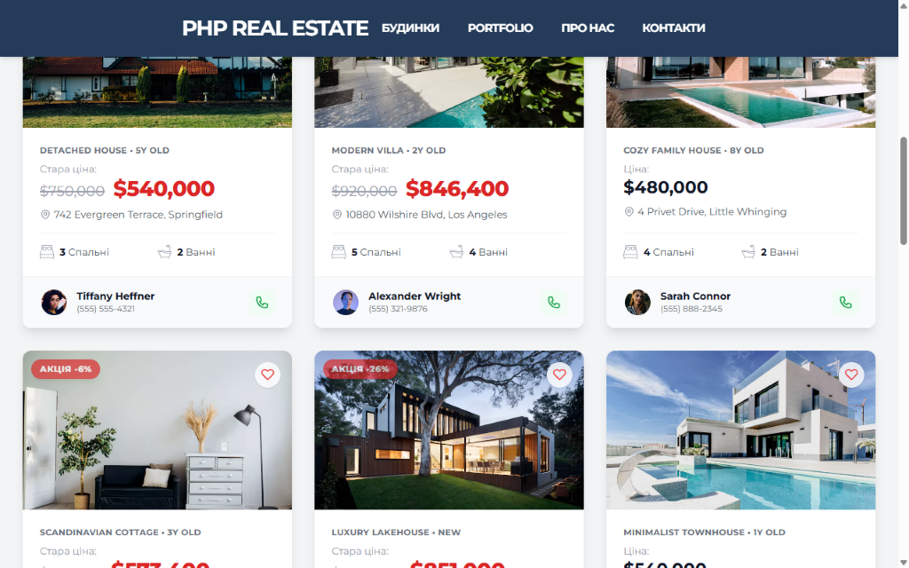
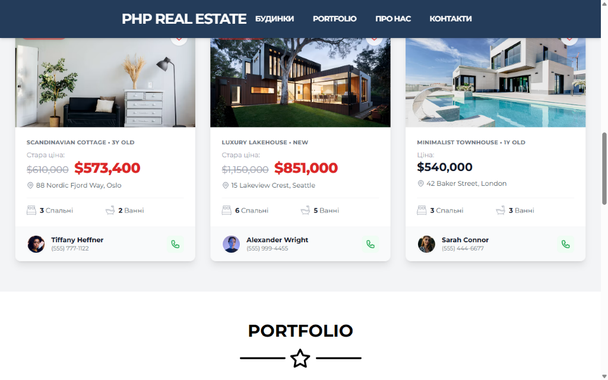
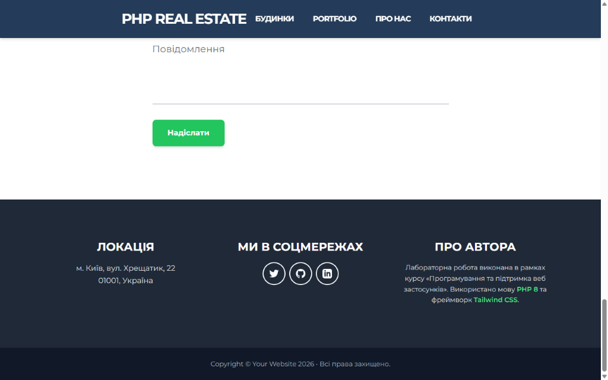

# ЗВІТ
## про виконання лабораторної роботи №6
### з дисципліни «Програмування та підтримка веб застосунків»

**Тема:** Основи мови програмування PHP. Функції та об'єкти в PHP  
**Мета:** Навчитися працювати з мовою PHP та її особливостями, ознайомитися з використанням функцій, об'єктів та їхніх методів.

---

## 1. Теоретичні відомості

Мова **PHP** (Hypertext Preprocessor) — це одна з найпопулярніших серверних скриптових мов програмування для веб-розробки. Основні можливості та концепції, що розглядаються у роботі:
1. **Інтеграція з HTML:** PHP-код інтерпретується на стороні сервера, а клієнту віддається чистий HTML/CSS. Для вставки результатів виразів використовується короткий синтаксис `<?= $expression ?>`.
2. **Вбудовані функції:**
   - `date('Y')` — повертає поточний 4-значний рік на сервері.
   - `rand($min, $max)` — генератор випадкових чисел для імітації бізнес-логіки (наприклад, акційних знижок).
   - `number_format($number, $decimals, $dec_point, $thousands_sep)` — форматування числових значень цін із роздільниками тисяч.
3. **Функції користувача:**
   - Декларація параметрів та значень, що повертаються, зі строгою типізацією (`string`, `int`, `float`, `array`).
   - Підтримка параметрів за замовчуванням.
   - Використання багаторядкових рядків `<<<HTML ... HTML;` (Heredoc) для чистої генерації складних HTML-структур.
4. **Об'єктно-орієнтоване програмування (ООП) в PHP 8:**
   - Оголошення класу `House` з чітко визначеними типами властивостей.
   - Конструктор `__construct()` для ініціалізації екземплярів об'єктів.
   - Власні методи класу (наприклад, форматування валюти).

---

## 2. Хід роботи та виконання завдань

### Завдання 1. Встановлення та налаштування PHP сервера

Для розгортання та перевірки роботи веб-застосунку налаштовано два способи запуску:
1. **Вбудований локальний сервер PHP (CLI Built-in Server):**
   Запускається безпосередньо з робочої директорії:
   ```powershell
   php -S 127.0.0.1:8000 -t .
   ```
   Сайт одразу доступний за адресою: `http://127.0.0.1:8000/`.

2. **Контейнеризація за допомогою Docker (`docker-compose.yml`):**
   Створено конфігураційний файл `docker-compose.yml` для автоматичного запуску у контейнері Docker:
   ```yaml
   version: '3.8'

   services:
     web:
       image: php:8.3-apache
       container_name: lab6_php_server
       ports:
         - "8080:80"
       volumes:
         - ./:/var/www/html/
       restart: always
   ```
   Команда запуску: `docker compose up -d` (доступ за адресою `http://localhost:8080/`).

---

### Завдання 2. Створення профілю на GitHub та структура гілок

1. Створено та налаштовано локальний Git-репозиторій:
   ```powershell
   git init
   git config user.name "Student"
   git config user.email "student@example.com"
   ```
2. Створено файл `.gitignore` для виключення зайвих файлів:
   ```text
   .idea/
   .vscode/
   *.log
   codepen.html
   ```
3. Створено гілку `main` з початковим комітом та виділено робочу гілку `lab6`:
   ```powershell
   git branch -M main
   git checkout -b lab6
   git add .
   git commit -m "feat(lab6): Complete laboratory work #6 on PHP basics, functions, and OOP"
   ```
4. Для публікації результатів на GitHub використовується команда:
   ```powershell
   git remote add origin https://github.com/<ваш-профіль>/web-programming.git
   git push -u origin lab6
   ```

---

### Завдання 3. Динамічне виведення блоку "About" за допомогою функції PHP

За основу взято приклад з CodePen (`https://codepen.io/gmyynzug-the-sasster/pen/GRexmVW`).  
У файлі `includes/functions.php` написано функцію `renderAboutBlock()`:

```php
function renderAboutBlock(
    string $heading = 'About',
    string $col1 = 'Freelancer is a free tailwind css theme created from Freelancer theme by Start Bootstrap...',
    string $col2 = 'You can create your own custom avatar for the masthead...',
    string $btnText = 'Free Download!'
): string {
    $headingEscaped = htmlspecialchars($heading);
    $col1Escaped = htmlspecialchars($col1);
    $col2Escaped = htmlspecialchars($col2);
    $btnTextEscaped = htmlspecialchars($btnText);

    return <<<HTML
  <section class="bg-green-500 -mt-12 py-16">
    <h1 class="text-center uppercase text-white text-4xl font-bold leading-none tracking-normal">
      {$headingEscaped}
    </h1>
    <div class="flex flex-row items-center justify-center py-4">
      <span class="h-1 w-24 bg-white rounded-full mx-2"></span>
      <svg class="h-12 fill-current text-white" xmlns="http://www.w3.org/2000/svg" viewBox="0 0 24 24">
        <path d="M6.1 21.98a1 1 0 0 1-1.45-1.06l1.03-6.03-4.38-4.26a1 1 0 0 1 .56-1.71l6.05-.88 2.7-5.48a1 1 0 0 1 1.8 0l2.7 5.48 6.06.88a1 1 0 0 1 .55 1.7l-4.38 4.27 1.04 6.03a1 1 0 0 1-1.46 1.06l-5.4-2.85-5.42 2.85zm4.95-4.87a1 1 0 0 1 .93 0l4.08 2.15-.78-4.55a1 1 0 0 1 .29-.88l3.3-3.22-4.56-.67a1 1 0 0 1-.76-.54l-2.04-4.14L9.47 9.4a1 1 0 0 1-.75.54l-4.57.67 3.3 3.22a1 1 0 0 1 .3.88l-.79 4.55 4.09-2.15z"/>
      </svg>
      <span class="h-1 w-24 bg-white rounded-full mx-2"></span>
    </div>
    <div class="flex flex-col lg:flex-row max-w-lg md:max-w-2xl lg:max-w-3xl mx-auto">
      <div class="mx-6 text-white text-xl py-4">{$col1Escaped}</div>
      <div class="mx-6 text-white text-xl py-4">{$col2Escaped}</div>
    </div>
    <div class="flex justify-center py-8">
      <button class="bg-transparent hover:bg-white hover:text-black text-white border-2 border-white font-normal py-3 px-5 rounded-lg inline-flex items-center transition duration-200">
        <svg class="fill-current w-4 h-4 mr-2" xmlns="http://www.w3.org/2000/svg" viewBox="0 0 20 20">
          <path d="M13 8V2H7v6H2l8 8 8-8h-5zM0 18h20v2H0v-2z"/>
        </svg>
        <span>{$btnTextEscaped}</span>
      </button>
    </div>
  </section>
HTML;
}
```

У `index.php` замість статичного коду розміщено виклик:
```php
<div id="about">
  <?= renderAboutBlock(
      heading: 'Про Проект',
      col1: 'Freelancer is a free tailwind css theme created from Freelancer theme by Start Bootstrap...',
      col2: 'У цій версії всі динамічні секції побудовані на об\'єктній моделі PHP 8...',
      btnText: 'Завантажити Звіт'
  ); ?>
</div>
```

---

### Завдання 4. Динамічне виведення поточного року у футері

Замість статичного значення 2019 використано функцію PHP `date('Y')`:
```php
$currentYear = date('Y');
```

У розмітці футера:
```html
<footer class="bg-gray-900 py-6 border-t border-gray-800">
  <p class="text-center text-gray-400 text-sm">
    Copyright &copy; Your Website <?= $currentYear; ?> &bull; Всі права захищено.
  </p>
</footer>
```

---

### Завдання 5. Динамічна локація у футері

Оголошено змінну `$location`:
```php
$location = "м. Київ, вул. Хрещатик, 22<br>01001, Україна";
```

Виведено у лівій колонці футера:
```html
<div class="p-6 md:w-1/3">
  <h3 class="uppercase text-2xl font-bold leading-none tracking-normal pb-5">Локація</h3>
  <p class="text-gray-300 leading-relaxed"><?= $location; ?></p>
</div>
```

---

### Завдання 6. Створення класу House

У файлі `classes/House.php` визначено клас `House`:
```php
<?php
class House {
    public string $name;
    public float $price;
    public string $address;
    public string $phone;
    public string $image;
    public int $bedrooms;
    public int $bathrooms;
    public string $realtorName;
    public string $realtorAvatar;

    public function __construct(
        string $name,
        float $price,
        string $address,
        string $phone,
        string $image,
        int $bedrooms,
        int $bathrooms,
        string $realtorName = 'Tiffany Heffner',
        string $realtorAvatar = 'https://images.unsplash.com/photo-1500522144261-ea64433bbe27?auto=format&fit=crop&w=751&q=80'
    ) {
        $this->name = $name;
        $this->price = $price;
        $this->address = $address;
        $this->phone = $phone;
        $this->image = $image;
        $this->bedrooms = $bedrooms;
        $this->bathrooms = $bathrooms;
        $this->realtorName = $realtorName;
        $this->realtorAvatar = $realtorAvatar;
    }

    public function getFormattedPrice(?float $customPrice = null): string {
        $amount = $customPrice ?? $this->price;
        return '$' . number_format($amount, 0, '.', ',');
    }
}
```

---

### Завдання 7. Ініціалізація екземплярів та циклічне виведення

Створено масив `$houses` з 6 різноманітних об'єктів `House`:
```php
$houses = [
    new House(
        name: "Detached house • 5y old",
        price: 750000,
        address: "742 Evergreen Terrace, Springfield",
        phone: "(555) 555-4321",
        image: "https://images.unsplash.com/photo-1475855581690-80accde3ae2b?auto=format&fit=crop&w=750&q=80",
        bedrooms: 3,
        bathrooms: 2
    ),
    new House(
        name: "Modern Villa • 2y old",
        price: 920000,
        address: "10880 Wilshire Blvd, Los Angeles",
        phone: "(555) 321-9876",
        image: "https://images.unsplash.com/photo-1512917774080-9991f1c4c750?auto=format&fit=crop&w=750&q=80",
        bedrooms: 5,
        bathrooms: 4,
        realtorName: "Alexander Wright"
    ),
    // ... додаткові будинки
];
```

Вивід карток за допомогою циклу `foreach`:
```php
<div class="grid grid-cols-1 md:grid-cols-2 lg:grid-cols-3 gap-8">
  <?php foreach ($houses as $house): ?>
    ...
  <?php endforeach; ?>
</div>
```

---

### Завдання 8. Функція акції та відображення знижки (0–30%)

У файлі `includes/functions.php` реалізовано логіку акцій:
```php
function calculateHousePromo(int $chancePercent = 60, int $maxPercent = 30): array {
    $maxPercent = min(30, max(1, $maxPercent));
    $hasPromo = (rand(1, 100) <= $chancePercent);

    if ($hasPromo) {
        $discount = rand(5, $maxPercent); // знижка від 5% до 30%
        return [
            'isPromo' => true,
            'percent' => $discount
        ];
    }

    return [
        'isPromo' => false,
        'percent' => 0
    ];
}

function getDiscountedPrice(float $originalPrice, int $percent): float {
    if ($percent <= 0) {
        return $originalPrice;
    }
    return round($originalPrice * (1 - ($percent / 100)), 2);
}
```

У циклі виведення:
```php
<?php
  $promo = calculateHousePromo(chancePercent: 60, maxPercent: 30);
  $hasPromo = $promo['isPromo'] && ($promo['percent'] > 0);
?>
<?php if ($hasPromo): ?>
  <?php $discountedPrice = getDiscountedPrice($house->price, $promo['percent']); ?>
  <div class="my-2">
    <div class="text-sm text-gray-400 font-medium">Стара ціна:</div>
    <div class="flex items-baseline space-x-3">
      <!-- Перекреслена ціна -->
      <span class="text-xl text-gray-400 line-through">
        <?= $house->getFormattedPrice($house->price) ?>
      </span>
      <!-- Акційна ціна: червоний колір + більший шрифт -->
      <span class="text-3xl font-extrabold text-red-600 tracking-tight">
        <?= $house->getFormattedPrice($discountedPrice) ?>
      </span>
    </div>
  </div>
<?php else: ?>
  <div class="my-2">
    <div class="text-sm text-gray-400 font-medium">Ціна:</div>
    <p class="text-2xl font-bold text-gray-900">
      <?= $house->getFormattedPrice($house->price) ?>
    </p>
  </div>
<?php endif; ?>
```

---

## 3. Результати роботи та скріншоти тестування

Всі компоненти застосунку були протестовані в браузері. Нижче наведено скріншоти роботи веб-сторінки:

### 3.1. Динамічний каталог будинків з акційними цінами (Завдання 6, 7, 8)
Картки генеруються на основі екземплярів класу `House`. Будинки, що підпадають під акцію, мають анімований бейдж, перекреслену базову ціну та виділену червону ціну зі знижкою.



### 3.2. Блок "About", згенерований функцією PHP (Завдання 3)
Секція відрендерена викликом функції `renderAboutBlock()`.



### 3.3. Футер сайту з динамічною локацією та актуальним роком (Завдання 4, 5)
У лівій частині відображається адреса зі змінної `$location`, у правому блоці — інформація про автора, а в копірайті виводиться поточний рік через `date('Y')`.



---

## 4. Висновки

У ході виконання лабораторної роботи №6:
1. Засвоєно практичні навички роботи з мовою серверного програмування PHP 8.
2. Налаштовано середовище виконання веб-сервера (вбудований сервер PHP та конфігурація Docker).
3. Організовано контроль версій у Git з гілками `main` та `lab6`.
4. Реалізовано користувацькі функції з типізацією для генерації компонентів інтерфейсу та випадкового розрахунку параметрів акцій.
5. Застосовано стандартні функції PHP: `date()`, `rand()`, `number_format()`, `htmlspecialchars()`.
6. Спроектовано клас `House` з типізованими полями, конструктором та методами згідно з парадигмою ООП.
7. Реалізовано динамічну верстку з циклічним виведенням об'єктів та умовним стилізуванням за допомогою класів Tailwind CSS.
